<div align="center">


# Beyond™ Gateway

## Free your world.

**A home network anyone can run. One router, one calm app, and the way back always one cable away.**

It finds your internet by itself, pauses the kids' devices with one switch, and keeps itself up to date overnight.<br>
Free and open source, built in Aotearoa by [Beyond](https://gobeyond.co.nz). The router side of [Beyond™ TV](https://github.com/YeahBuddyNZ/Beyond.TV) and Beyond Family.

[Install](#install) · [Routers](#routers) · [Updates](#updates) · [Help](#help) · [Going back](#going-back) · [Change the code](#change-the-code) · [Roadmap](#roadmap)

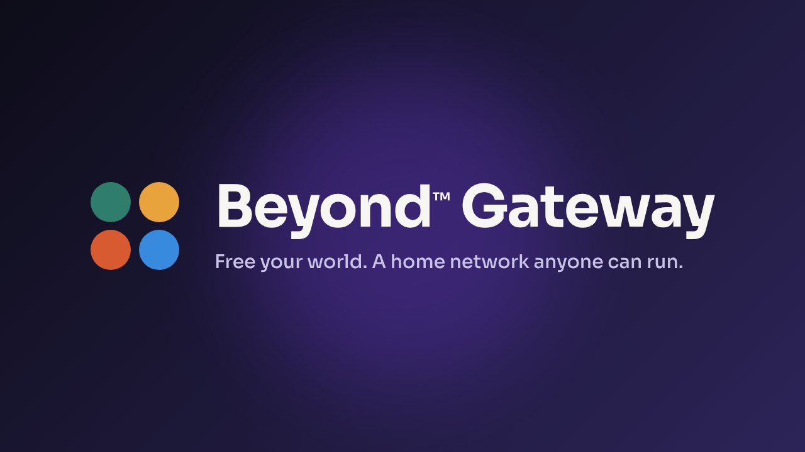

</div>

## Screenshots

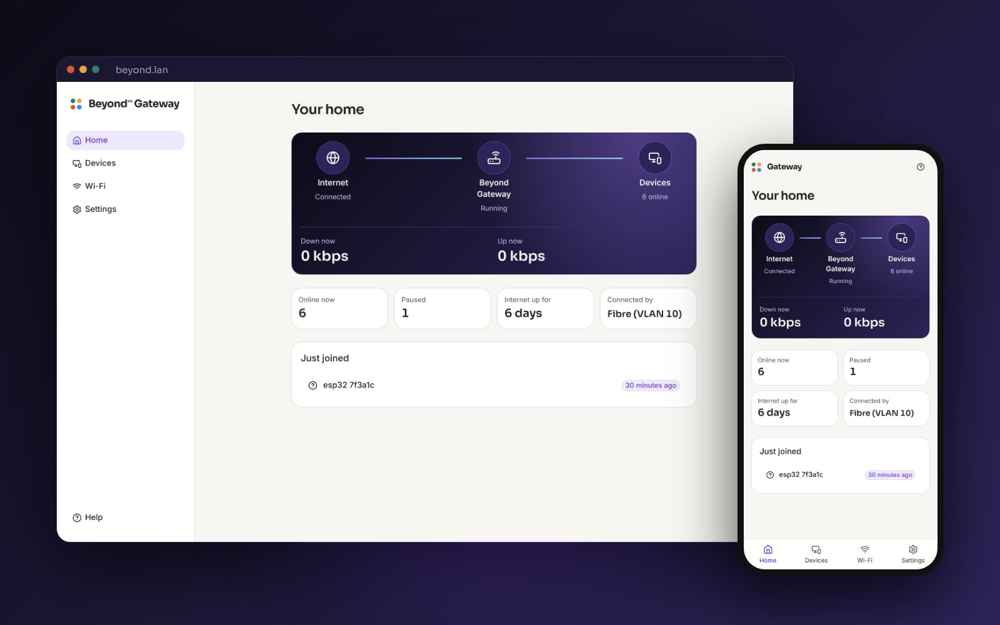

<table>
<tr><td>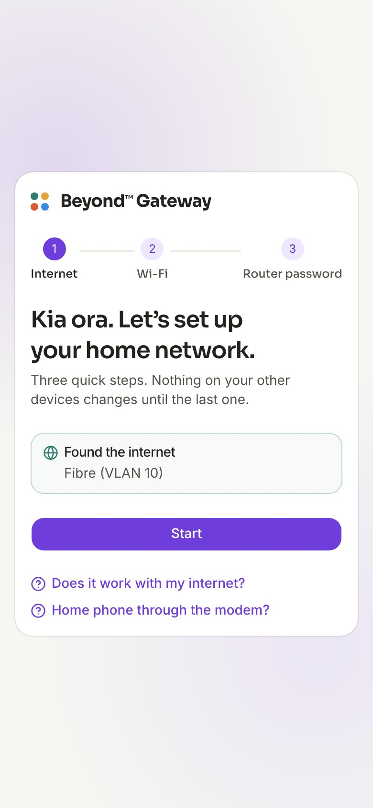</td>
<td>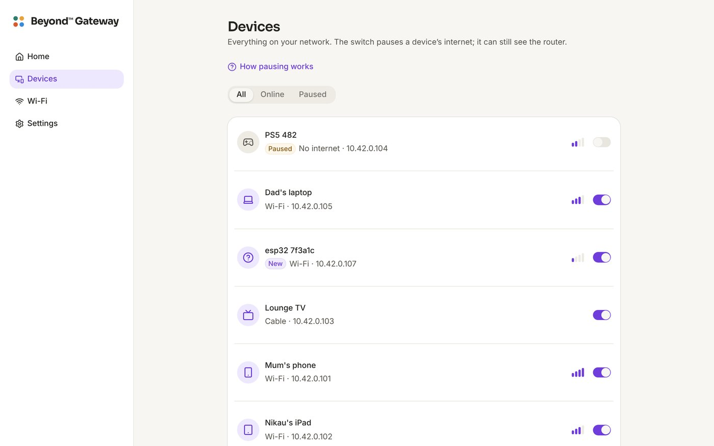</td></tr>
<tr><td>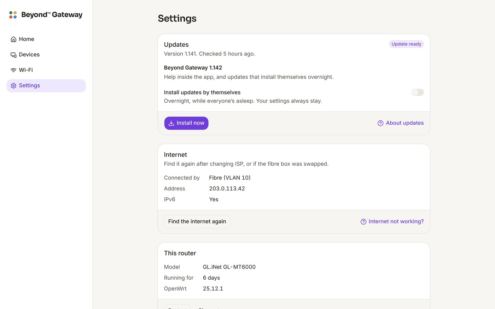</td>
<td>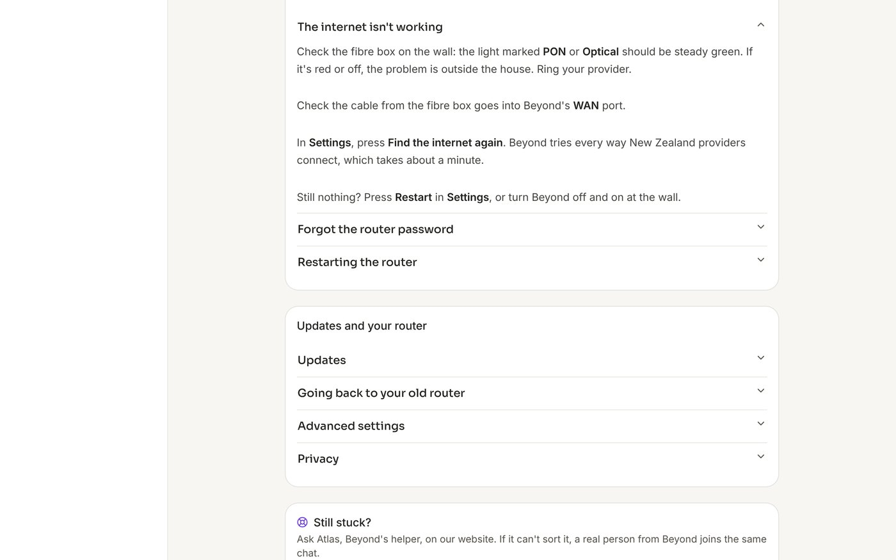</td></tr>
<tr><td>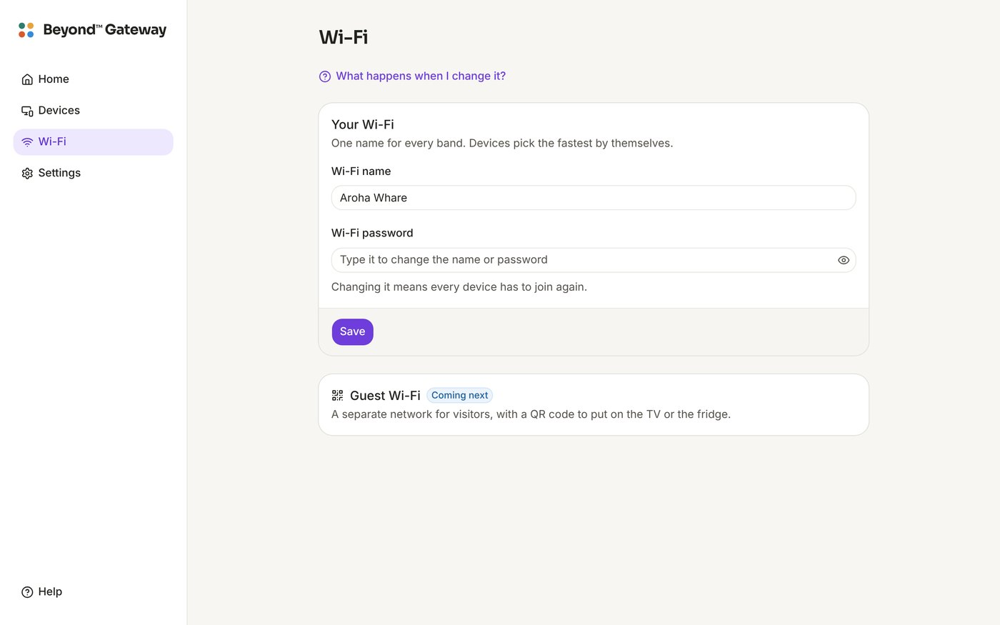</td>
<td>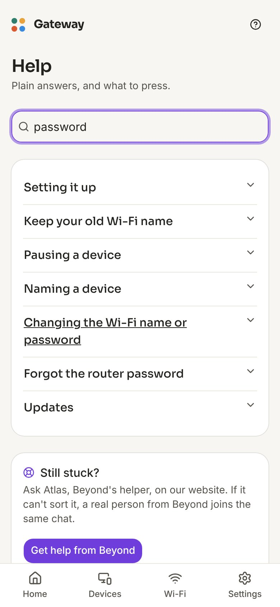</td></tr>
<tr><td>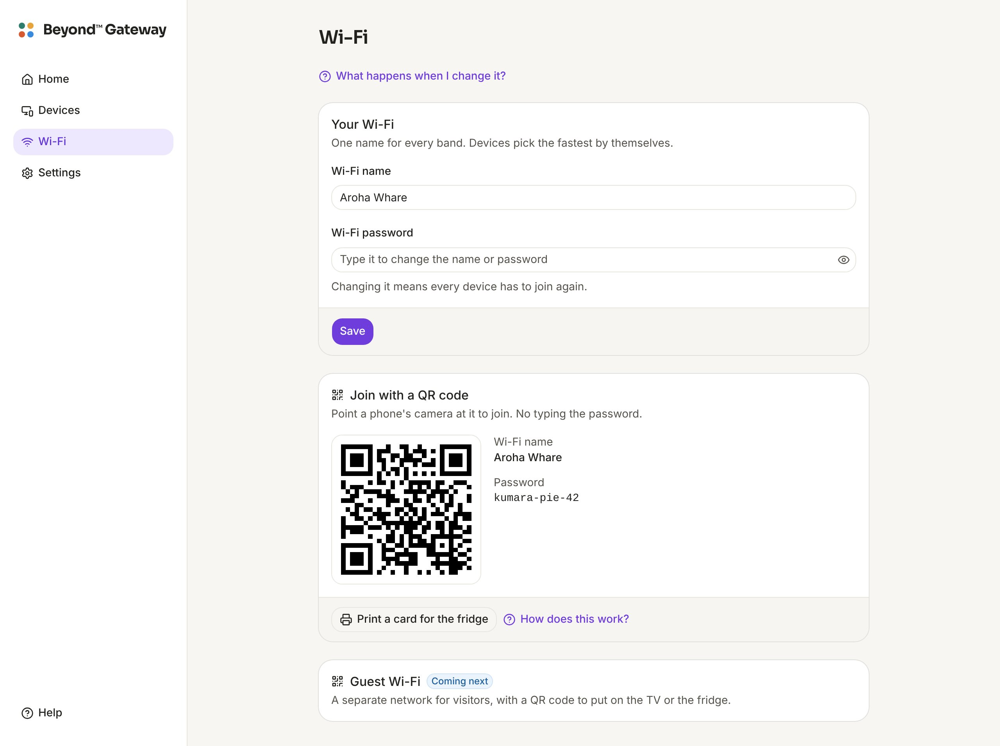</td>
<td>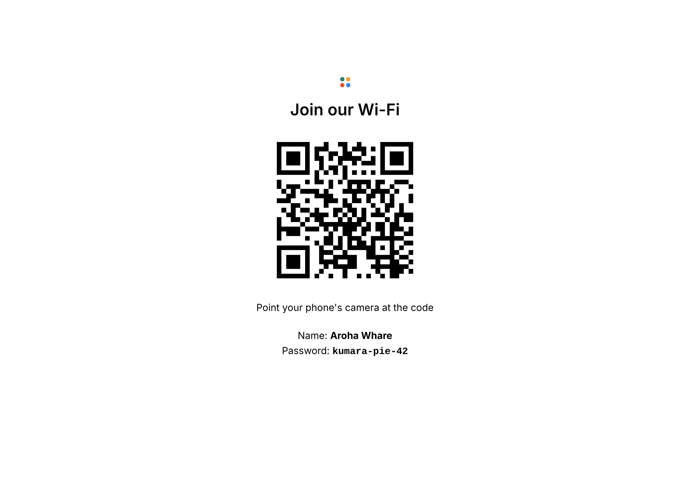</td></tr>
<tr><td>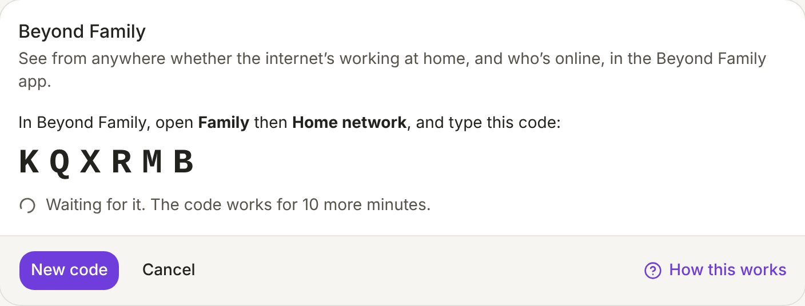</td>
<td>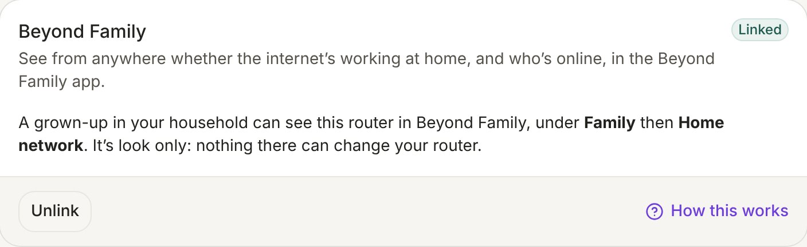</td></tr>
</table>

## What you get

- **It finds your internet by itself.** Plug it into the fibre box on the wall and it works out how your provider connects (VLAN 10 for One NZ, Spark, 2degrees and most New Zealand fibre, plain DHCP, or PPPoE). Nobody types a VLAN.
- **Three minutes to set up, from your phone.** Join *Beyond Setup*, open `beyond.lan`, and use your old Wi-Fi name and password so every device rejoins by itself.
- **Your home at a glance.** Internet, the router and your devices, live speed, and anything that joined today.
- **Pause anything.** Every phone, TV and console in the house, with one switch each. It stays on the Wi-Fi and comes straight back when you un-pause it.
- **Join with a QR code.** Visitors point their phone's camera at the code on the *Wi-Fi* page and they're on, no password to type. *Print a card for the fridge* puts it on paper.
- **See it from anywhere in [Beyond Family](https://beyondfamily.app).** *Connect to Beyond Family* in *Settings* shows a code; type it under *Family*, *Home network*, and a grown-up can see from work whether the internet's up at home and who's online, with your Beyond TVs alongside. Look only: nothing there can change the router.
- **Keeps itself up to date.** It checks each night and installs only versions Beyond has signed, keeping every setting. One press, or turn on *Install updates by themselves*.
- **Help inside the app.** Plain answers on every screen, and the same answers at [gobeyond.nz/gateway](https://gobeyond.nz/gateway).
- **Private.** Your devices and what they do never leave the house. It asks the internet whether there's a new version, and, only if you link it to Beyond Family, sends your household the names you gave your devices and whether each is online.
- **Beyond's look.** The four dots, Beyond's purple and Sora, the same family as [Beyond™ TV](https://github.com/YeahBuddyNZ/Beyond.TV) and [Beyond Family](https://beyondfamily.app).

## How it plugs in

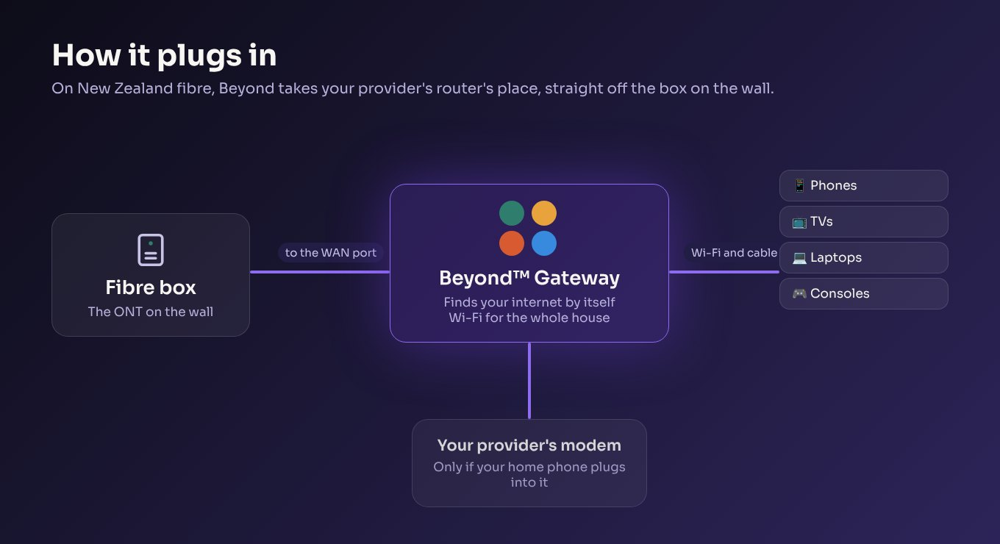

On New Zealand fibre the box on the wall (the ONT) is separate from your provider's router, so Beyond takes the router's place. Your internet plan doesn't change, and the old router goes back in the cupboard.

**A home phone through the modem?** Keep the modem, plugged into one of Beyond's ports just for the phone, or move to your provider's calling app.
**On copper (VDSL), 4G or 5G?** Keep your provider's modem as the modem and plug Beyond into it. Beyond works behind it.

## Roadmap

1. **Per-person Wi-Fi passwords.** Each kid joins with their own password, so a pause follows them even if they change their phone's settings.
2. **New devices wait for a grown-up.** Anything new joins a waiting list until someone says yes.
3. **Beyond Family, managing.** Seeing the router from Beyond Family is here (look only). Next: pausing a device from your phone, grown-ups only, with an email on every change.
4. **Guest Wi-Fi** with a QR code for the TV or the fridge.
5. **Beyond Shield:** ads and scam sites blocked for the whole house.
6. **A second router as a mesh point** for big houses.

## Install

About ten minutes. You need a [supported router](#routers), a laptop, and a cable.

### GL.iNet Flint 2 and Beryl AX

These run GL.iNet's own system out of the box, which has an *Upgrade* page that takes Beyond's file directly.

1. **Download Beyond for your router** from the latest release (or one click at [gobeyond.nz/gateway](https://gobeyond.nz/gateway)):
   - Flint 2 (GL-MT6000): [`beyond-gateway-glinet_gl-mt6000-sysupgrade.bin`](https://github.com/YeahBuddyNZ/Beyond-Gateway/releases/latest/download/beyond-gateway-glinet_gl-mt6000-sysupgrade.bin)
   - Beryl AX (GL-MT3000): [`beyond-gateway-glinet_gl-mt3000-sysupgrade.bin`](https://github.com/YeahBuddyNZ/Beyond-Gateway/releases/latest/download/beyond-gateway-glinet_gl-mt3000-sysupgrade.bin)
2. **Plug a laptop into the router** with a cable, power it on, and open **`192.168.8.1`**. Set GL.iNet's admin password if it asks (you won't need it again).
3. **Upgrade.** *System* → *Upgrade* → *Local Upgrade*. Choose the file, **untick *Keep Settings***, and press *Install*. Don't unplug it: it restarts as Beyond Gateway in about three minutes.
4. **Plug the cable from the fibre box into the WAN port.** Join the **Beyond Setup** Wi-Fi on your phone, open **`beyond.lan`**, and follow the three steps.

Not yet tried on a real Flint 2: the first one is the test. If anything goes wrong, see [Going back](#going-back).

### OpenWrt One

1. Download [`beyond-gateway-openwrt_one-sysupgrade.itb`](https://github.com/YeahBuddyNZ/Beyond-Gateway/releases/latest/download/beyond-gateway-openwrt_one-sysupgrade.itb).
2. Open its OpenWrt page at `192.168.1.1`, then *System* → *Backup / Flash Firmware* → *Flash image*, choose the file and **untick *Keep settings***.
3. Plug in the fibre box and follow the three steps at `beyond.lan`.

### Already running Beyond Gateway?

You never need to do this again: *Settings* → *Updates* installs new versions and keeps your settings.

## Routers

Beyond is built for these routers. Each has a 2.5 Gb WAN port, so Hyperfibre plans work too.

| Router | Good for | Wi-Fi | Install |
|---|---|---|---|
| **GL.iNet Flint 2 (GL-MT6000)** | Most homes. The one we recommend | Wi-Fi 6 | GL.iNet's *Upgrade* page |
| GL.iNet Beryl AX (GL-MT3000) | Flats, baches and travel | Wi-Fi 6 | GL.iNet's *Upgrade* page |
| OpenWrt One | People who like to tinker. Made by the OpenWrt project | Wi-Fi 6 | Its own OpenWrt page |

**Runs OpenWrt, no Beyond build yet:** ASUS TUF-AX4200, ASUS RT-AX59U, Xiaomi AX3000T, Cudy WR3000 (v1), TP-Link Archer AX23 (v1), D-Link DIR-X1860 (B1), Banana Pi R4. Ask for one at [gobeyond.nz/gateway](https://gobeyond.nz/gateway#support) and we'll look at it.

**Can't run it:** your provider's router (Spark Smart Modem, One NZ Ultra Hub, 2degrees and the rest have locked software the provider can overwrite at any time), Netcomm NF18ACV and NF8AC, Huawei HG659, ASUS DSL-AC68U, TP-Link Archer AX10, AX1500, AX55 (AX3000), AXE75 and C9, TP-Link Deco X55, ASUS RT-AX86U Pro, RT-AX3000 and RT-AX58U, and Netgear Orbi RBR350. None of these are in OpenWrt, so nothing can be put on them safely.

Checked against OpenWrt 25.12's own source on 22/10/2026. A router with a model "version" (v1, v3, B1) is only supported in that version: it's on the sticker underneath.

## Updates

Beyond Gateway checks for a new version each night, between 2 and 5am. When there is one, *Settings* says **Update ready**: one press installs it, and the internet is off for about three minutes. Turn on **Install updates by themselves** and it installs overnight instead.

- **Only Beyond's versions.** The list of versions is signed with Beyond's key, and the file's checksum is in that signed list. A list or a file that doesn't match is thrown away.
- **Only newer versions**, and only the file made for your router, tested with `sysupgrade -T` before it's used.
- **Every setting stays:** Wi-Fi, the router password, device names and pauses.

<details>
<summary>For whoever runs the releases</summary>

Every build of `main` becomes the latest release, `gateway-<build>`, with each router's file under a fixed name and `latest.txt`, signed as `latest.txt.sig` (`tools/release-list.mjs`, then `tools/update-key.mjs sign`). Routers built without the key say *Updates off* and never update themselves.

The key is made once and lives only in GitHub:

```bash
node tools/update-key.mjs new
```

It prints a secret. Paste it at GitHub → *Settings* → *Secrets and variables* → *Actions* → *New repository secret*, named `GATEWAY_UPDATE_KEY`, and keep a copy somewhere safe (a password manager). Never commit it or paste it anywhere else. Lose it and every router has to be flashed again by hand to take a new key; leak it and someone could sign an update, so make a new one and flash again.

</details>

## Help

The same answers as the app's *Help* (`web/src/help.ts`).

**The internet isn't working.** Check the fibre box: the **PON** or **Optical** light should be steady green (red or off means the problem is outside the house, so ring your provider). Check the fibre box's cable is in Beyond's **WAN** port. Then *Settings* → **Find the internet again**, which tries every way New Zealand providers connect. Still nothing? **Restart**.

**Forgot the router password.** Hold the reset button for 10 seconds. It starts again as new with the *Beyond Setup* Wi-Fi; set it up with your usual Wi-Fi name and password and everything rejoins.

**Changing the Wi-Fi name or password.** *Wi-Fi*, type it, *Save*. Everything drops off for a moment; devices that know the new password rejoin by themselves.

**Joining with a QR code.** *Wi-Fi*, *Show the code*, and point a phone's camera at it. *Print a card for the fridge* prints it with the name and password. Change the password and print a new card: the old one stops working.

**Seeing it from Beyond Family.** *Settings*, *Connect to Beyond Family*. In the Beyond Family app, *Family*, *Home network*, type the six letter code. *Unlink* on either side stops it straight away.

**Pausing a device.** *Devices*, flick its switch. It stays on the Wi-Fi but can't reach the internet until you flick it back.

**The internet is slow.** *Home* shows what's being used right now: a big number means something is downloading. Far from the router? Walls slow Wi-Fi down; a mesh point is coming.

**Still stuck?** [gobeyond.nz/gateway](https://gobeyond.nz/gateway#support): ask Atlas, or send us a message.

## Going back

**To your old router:** unplug the fibre box's cable from Beyond's WAN port and plug it into your old router. That's all. Nothing about your internet plan changed.

**To the router's own software:** GL.iNet routers have a recovery page that can't be overwritten. Unplug the power, hold the reset button, plug the power back in, and let go when the light flashes. Open `192.168.1.1` on a laptop plugged into it and upload GL.iNet's firmware from gl-inet.com.

**For people who know networks:** OpenWrt's own screens are under *Settings* → *Advanced settings*.

## What it changes

Only the router you put it on. It replaces that router's software with OpenWrt and the Beyond app. Your provider's router, your fibre box and your internet plan are never touched.

## Change the code

```bash
cd web && npm install && npm run dev
# open http://localhost:5173/?preview          a made-up house
#      http://localhost:5173/?preview=setup    first-run setup
#      http://localhost:5173/?preview&update   with an update waiting
```

The preview runs against `web/src/mock.js` (made-up names only). Building the firmware:

```bash
./build.sh                  # GL.iNet Flint 2
./build.sh openwrt_one      # or another router from the table
```

Linux x86_64 with make, curl, zstd and Node.js 20 or newer. It builds the app, downloads OpenWrt's Image Builder (checked against OpenWrt's checksums), adds the packages in `packages.txt`, everything in `files/` and the built app, and leaves the images in `out/<router>/`. CI builds all three on every push. Set `GATEWAY_UPDATE_KEY` for a build that updates itself.

### How it fits together

- `files/` goes onto the router as it is: first-boot settings (`etc/uci-defaults/`), the internet finder (`usr/libexec/beyond/wan-detect`), pausing (`usr/libexec/beyond/apply-pause`), updates (`usr/libexec/beyond/update`), and the `beyond` ubus object the app talks to (`usr/share/rpcd/ucode/beyond.uc`, with who may call what in `usr/share/rpcd/acl.d/beyond.json`).
- `web/` is the app: React, Vite and Tailwind, with its parts from ReUI (shadcn's `base-nova` style on Base UI), served by the router at `/beyond/`.
- `tests/` runs with `sh tests/run.sh`.

## Privacy

What happens in your house stays on your router: your devices, their names and what they do are never sent anywhere. Once a night it asks GitHub, where Beyond's releases live, whether there's a new version.

Linked to Beyond Family, it also sends your own household, once a minute: whether the internet is up and how fast, the names you gave your devices, and whether each is online, paused or new. Never a device's address (MAC or IP), its own name for itself, your Wi-Fi password or anything anyone does online. Beyond Family can't send the router anything back but "linked" or "not linked".

## Credits

[OpenWrt](https://openwrt.org) and [LuCI](https://github.com/openwrt/luci), [ReUI](https://reui.io) and [shadcn/ui](https://ui.shadcn.com), [Base UI](https://base-ui.com) and [uqr](https://github.com/unjs/uqr) for the QR codes, [Lucide](https://lucide.dev) icons and the [Sora](https://github.com/sora-xor/sora-font) typeface.

## Licence

GPL-3.0 (see `LICENSE`), like Beyond TV. OpenWrt is GPL-2.0 and LuCI Apache-2.0; their source is at openwrt.org and this repo is how our images are made. Sora is under the SIL Open Font Licence (`web/public/LICENSE-Sora-OFL.txt`). "Like UniFi" means the feel only: no Ubiquiti code or names.
